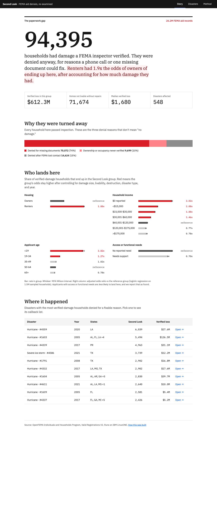
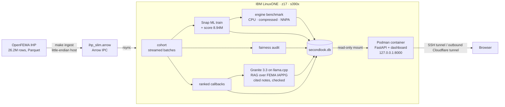

# Second Look

**Find the disaster survivors FEMA turned away even though an inspector verified their damage, and get them a callback.**

Team Second Look · IBM Z Datathon 2026 (Shooting Stars Foundation × IBM) · Theme 3: Wildcard · Event code SSF2026

Built and run on **IBM LinuxONE (IBM z17, s390x)** with **IBM Snap ML**, the **Telum AI accelerator (NNPA)**, **IBM Granite**, and a rootless **Podman** container.

**Try it:** [static snapshot on GitHub Pages](https://mahirrrr.github.io/ibm-z-datathon-2026/), which always works · [live on the z17](https://divisions-films-jesse-nsw.trycloudflare.com), best effort (a Cloudflare quick tunnel, so the URL changes if the VM restarts)



## The problem

After a disaster, FEMA sends an inspector, who confirms the damage. Then some of those households are denied anyway: a document was missing, FEMA couldn't reach them, or nobody verified that they owned or lived in the home. None of these reasons means "no damage", and a caseworker can fix each of them with a phone call.

FEMA publishes every application for Individuals and Households Program aid: 26.2 million records. That makes the paperwork gap measurable.

## What we found (26,242,788 FEMA records)

- **94,395 households** had inspector-verified damage and were denied for a fixable reason.
  - 70,072 were missing documents.
  - 14,624 were cases where FEMA lost contact.
  - 9,699 never had ownership or occupancy verified.
- Their verified losses total **$612 million**, and **71,674** of those homes needed repairs before they were livable.
- The gap is not evenly spread. Among households with verified damage, adjusted for damage size, livability, destruction, disaster type, and year:

| Group (vs reference) | Adjusted odds of landing in the group |
|---|---|
| Renters (vs owners) | **1.88x** |
| $0 reported income (vs $60k–120k) | **3.02x** |
| Under $15k income | 2.08x |
| Age 19–34 (vs 50–64) | 1.27x |
| Age 65+ | 0.78x |
| Access or functional needs | 0.70x (less likely; we report it as found) |

## What it does

1. **Rule-based cohort** (`pipeline/cohort.py`). A household counts only when FEMA verified the damage, FEMA denied the aid, and the denial reason is fixable. FEMA's `ineligibleReason` codes are decoded in `pipeline/codebook.py`. It uses rules, not a model, so every flagged household can be explained in one sentence.
2. **Predictive model** (`pipeline/train.py`). An IBM Snap ML gradient-boosted model learns who ends up in the cohort, using only what FEMA knew after inspection and before deciding. It trains only on verified-damage households, and the test set is whole disasters the model never saw. That avoids the leakage trap where a naive model reaches 0.99 AUC by memorizing FEMA's eligibility rule.
3. **Fairness audit** (`pipeline/fairness.py`). Rates by renter status, income, age, and access needs come with 95% Wilson intervals, plus adjusted odds ratios from a logistic regression with controls.
4. **Ranked callback list** (`pipeline/rank.py`). Each disaster gets its own list. Households are ordered by verified loss, denial reason, whether the home is livable, and vulnerability. Each row comes with a sentence a caseworker can read aloud, such as *"FEMA verified $21,244 in damage; denied for missing documents; home needs repairs to be livable; lowest income band, age 65+, needs accessibility support."* The weights are a visible policy choice, not a learned one.
5. **Generative layer: IBM Granite with RAG over FEMA policy** (`pipeline/policy.py`, `pipeline/genai.py`). This is IBM's Predictive + Generative loan-approval lab run in reverse. The lab explains why a bank approved or denied a loan; we explain why a household FEMA denied deserves a second look.
   - **Retrieve.** FEMA's Individual Assistance Program and Policy Guide (IAPPG 1.1, chapter 3) is split into 89 passages, each labelled with its section and page, and indexed as TF-IDF vectors. Each denial reason may only cite its own sections: Identity, Insurance, Occupancy and Ownership for missing documents; Occupancy (renters) or Occupancy and Ownership (owners) for unverified homes; Applicant Communication for lost contact. The appeal timeline is always included.
   - **Generate.** IBM Granite 3.3 2B Instruct runs locally in llama.cpp on LinuxONE, from a big-endian GGUF build. It returns JSON: a "why flagged" note, a phone script, and the passages it used.
   - **Check.** Code rejects a note if it cites anything outside the retrieved passages, quotes a dollar amount that doesn't match the inspector's verified loss, or promises approval. Rejected notes fall back to the template script, and the Method page reports how many were rejected.
6. **Dashboard** (`api/`, `dashboard/`). FastAPI serves three pages built with IBM Plex type and Carbon colors:
   - Story: the finding
   - Disasters: caseworker console with CSV export and a side panel for Granite's cited note and script
   - Method: how it works, plus live LinuxONE runtime evidence

## Architecture



### Why two machines

FEMA's raw file is Parquet. The only pyarrow build available for s390x (conda `defaults`, 19.0.0) reads **numeric Parquet columns back as null on big-endian**, even for files it wrote itself. Arrow IPC (Feather) round-trips correctly on s390x and byte-swaps little-endian files on read. So:

- `make ingest` runs on any little-endian machine. It reads FEMA's Parquet and writes `data/processed/ihp_slim.arrow`.
- `make pipeline` runs on LinuxONE and covers every analysis step: cohort, model, fairness, ranking, benchmark, and database.

## Measured on IBM z17 (LinuxONE Community Cloud, 3 vCPU, 8 GB)

| Metric | Value |
|---|---|
| ROC AUC, 114 held-out disasters | **0.785** |
| Average precision | 0.078 (7x the 1.06% base rate) |
| Precision in the top 1,000 | **41.9%** (40x base rate) |
| Precision in the top 10,000 | 18.4% |
| Training time, Snap ML on 6.98M rows | 87.6s |
| Cohort labeling of 26.2M rows, peak memory | 364 MB (streamed) |

**Scoring all 8,938,750 verified-damage households with each Snap ML engine** (`pipeline/benchmark.py`):

| Engine | Seconds | Records/sec |
|---|---|---|
| CPU, standard trees | 21.3 | 419,197 |
| **CPU, Snap ML compressed trees** | **3.9** | **2,306,666** |
| Snap ML `zdnn_tensors` engine (built for the NNPA) | 37.3 | 239,909 |

All three engines return the same scores (max difference 1e-16). Because the Telum accelerator computes in reduced precision, identical scores mean we can't confirm that Snap ML's `zdnn_tensors` engine actually ran on the NNPA, so we don't count it as accelerator evidence. On this shared 3-vCPU VM, compressed trees were fastest for this model.

**Telum NNPA, measured with TensorFlow** (`pipeline/twin.py`, IBM's jupyter-lab-ml image, TensorFlow 2.18.1 + `ibm-zdnn-plugin` 2.3.0). A Keras twin of the model (133 inputs; Dense 64 → 32 → 1) trained on 1M households with the same disaster split. It scores the 1,961,754 held-out households:

| Device | Seconds | Records/sec |
|---|---|---|
| CPU (`NNPA_DEVICES=0`) | 1.38 | 1,424,337 |
| **Telum AI accelerator (NNPA, zDNN plugin)** | **1.12** | **1,745,681** |

The NNPA is **1.23x** faster at batch 8,192, best of 3 runs (1.34x at batch 65,536, though both devices are slower there). Scores differ by up to 0.0033 from the accelerator's reduced-precision math, which shows the NNPA path really ran. Twin ROC AUC is 0.716; the Snap ML model (0.785) is still the one that ranks callbacks.

Raw captures, screenshots, and the full run log are in [docs/evidence](docs/evidence/README.md).

## What we learned porting to s390x

Each of these cost real time, and each one is now handled in code:

1. **pyarrow Parquet on big-endian returns nulls for numbers.** We switched every intermediate file to Arrow IPC (`pipeline/frames.py`).
2. **26M rows × 33 columns in pandas used more than 16 GB.** Cohort labeling now streams Arrow record batches, and readers filter rows in Arrow before converting to pandas (`frames.read(..., where=...)`).
3. **Snap ML's zDNN build needs a newer libstdc++** than the conda environment ships. Run with `LD_PRELOAD=/lib/s390x-linux-gnu/libstdc++.so.6`.
4. **Snap ML on s390x crashes on NaN features** (`malloc(): invalid size`). Missing values become `-1`, which never occurs in codes or dollar amounts.
5. **A Snap ML model can only be optimized once.** The benchmark loads a fresh copy for each engine.
6. **FEMA's CDN blocks the VM's IP address**, so the raw file is uploaded from the ingest machine instead.
7. **GGUF models are little-endian.** We run a big-endian Granite build ([taronaeo/Granite-3.3-2B-Instruct-BE-GGUF](https://huggingface.co/taronaeo/Granite-3.3-2B-Instruct-BE-GGUF), from the llama.cpp s390x verified-models list).
8. **llama.cpp on z17 with GCC 13.** Native builds ask for `-march=arch15`, which needs GCC 15, so we build for z16. Without `-mzvector`, ggml quietly falls back to scalar code: Granite generated 1.2 tokens/s that way, against 4.5 tokens/s with vector extensions (llama-bench, Q4_0).
9. **llama-server's prompt cache (8 GB by default) squeezed the model out of RAM** on an 8 GB VM, and generation slowed down. The fix is `--cache-ram 0 -np 1 --load-mode none`.

## Security

- The container runs **rootless**, with a **read-only root filesystem**, **all Linux capabilities dropped**, `no-new-privileges`, and a non-root UID.
- The database is mounted **read-only**, and the API opens SQLite with `mode=ro`.
- The container listens on **localhost only**, and the VM opens no inbound port for it. Caseworkers use an SSH tunnel with key-only authentication. The public demo goes through an *outbound* Cloudflare quick tunnel (`cloudflared`, cross-compiled for s390x) to the same read-only API.
- The dataset has no names, addresses, or phone numbers. Households are opaque record IDs.

## How to run it

### 1. Get the data (any machine)

```bash
make data
```

### 2. Ingest on a little-endian machine (macOS or x86 Linux)

```bash
uv venv --python 3.12 .venv
uv pip install --python .venv/bin/python pandas pyarrow scikit-learn joblib pytest fastapi uvicorn httpx
make ingest
```

### 3. Set up LinuxONE (s390x, Ubuntu 24.04)

```bash
curl -fsSLo miniconda.sh https://repo.anaconda.com/miniconda/Miniconda3-latest-Linux-s390x.sh
bash miniconda.sh -b -p ~/miniconda3
~/miniconda3/bin/conda create -y -n secondlook python=3.12 pandas pyarrow scikit-learn joblib pytest
~/miniconda3/envs/secondlook/bin/pip install snapml fastapi uvicorn httpx
sudo apt-get install -y make podman libzdnn0
```

Copy the repository and `data/processed/ihp_slim.arrow` to the VM.

### 4. Run the pipeline on LinuxONE

```bash
export LD_PRELOAD=/lib/s390x-linux-gnu/libstdc++.so.6
make test PY=~/miniconda3/envs/secondlook/bin/python
make pipeline PY=~/miniconda3/envs/secondlook/bin/python
```

### 4b. Granite notes on LinuxONE (optional; the dashboard falls back to a template)

```bash
sudo apt-get install -y build-essential cmake
git clone --depth 1 https://github.com/ggml-org/llama.cpp && cd llama.cpp
cmake -S . -B build -DCMAKE_BUILD_TYPE=Release -DGGML_NATIVE=OFF -DLLAMA_CURL=OFF \
  "-DCMAKE_C_FLAGS=-march=z16 -mvx -mzvector" "-DCMAKE_CXX_FLAGS=-march=z16 -mvx -mzvector"
cmake --build build -j3 --target llama-server
curl -L -o ~/models/granite-3.3-2b-instruct-be.Q4_0.gguf \
  https://huggingface.co/taronaeo/Granite-3.3-2B-Instruct-BE-GGUF/resolve/main/granite-3.3-2b-instruct-be.Q4_0.gguf
build/bin/llama-server -m ~/models/granite-3.3-2b-instruct-be.Q4_0.gguf -c 4096 -np 1 --cache-ram 0 \
  --load-mode none -t 3 --jinja --host 127.0.0.1 --port 8081 --no-webui &
cd ~/ibm-z-datathon-2026 && make notes PY=~/miniconda3/envs/secondlook/bin/python
```

The policy passages (`docs/data/iappg_chunks.json`) are committed. `make policy` rebuilds them from FEMA's PDF on a machine with `pdftotext`.

### 5. Serve the dashboard from a container

```bash
podman build -t second-look .
podman run -d --name second-look --read-only --cap-drop=ALL --security-opt no-new-privileges \
  -p 127.0.0.1:8000:8000 -v ./secondlook.db:/app/secondlook.db:ro,Z second-look
```

Then, from your own machine:

```bash
ssh -N -i <key> -L 8100:127.0.0.1:8000 <user>@<vm-ip>
```

Open http://localhost:8100.

### 6. Public demo (optional)

```bash
python -m pipeline.static_site --out site --live-url https://<tunnel>   # GitHub Pages snapshot from the real API
CGO_ENABLED=0 GOOS=linux GOARCH=s390x go build -o cloudflared ./cmd/cloudflared   # no official s390x build
./cloudflared tunnel --no-autoupdate --url http://127.0.0.1:8000
```

## Repository layout

```
pipeline/
  ingest.py      FEMA Parquet → slim Arrow IPC (little-endian host)
  frames.py      Arrow IPC read/write with row filters
  codebook.py    decoded FEMA denial-reason codes and cohort tiers
  cohort.py      rule-based Second Look cohort, streamed in batches
  features.py    pre-decision features, disaster-level train/test split
  train.py       Snap ML (LinuxONE) or scikit-learn model, metrics, scores
  benchmark.py   Snap ML inference engines: CPU, compressed trees, NNPA
  fairness.py    rates with Wilson intervals, adjusted odds ratios
  rank.py        ranked callback list with "why flagged" sentences
  policy.py      FEMA IAPPG passages + TF-IDF retriever pinned per denial reason
  genai.py       Granite (llama.cpp) notes and scripts, citation/amount/promise checks
  twin.py        Keras twin of the model, CPU vs Telum NNPA via IBM's zDNN plugin
  store.py       everything into secondlook.db
  static_site.py GitHub Pages snapshot: every API response written to JSON
api/app.py       read-only FastAPI over secondlook.db + static dashboard
dashboard/       Story, Disasters, Method pages (IBM Plex, Carbon colors)
tests/           73 tests: cohort rules, fairness math, ranking, Arrow I/O, API, policy retrieval, Granite checks, twin encoding
Containerfile    rootless Podman image for the API and dashboard
docs/evidence/   LinuxONE captures and screenshots
```

## Open-source resources

- Data: [OpenFEMA Individuals and Households Program Valid Registrations V2](https://www.fema.gov/openfema-data-page/individuals-and-households-program-valid-registrations-v2)
- [IBM Snap ML](https://www.zurich.ibm.com/snapml/), [zDNN](https://github.com/IBM/zDNN)
- [IBM Granite 3.3 2B Instruct](https://huggingface.co/ibm-granite/granite-3.3-2b-instruct), as a [big-endian GGUF](https://huggingface.co/taronaeo/Granite-3.3-2B-Instruct-BE-GGUF), served by [llama.cpp](https://github.com/ggml-org/llama.cpp)
- [TensorFlow / Keras](https://www.tensorflow.org/) with [IBM Z Accelerated for TensorFlow (zDNN plugin)](https://github.com/IBM/ibmz-accelerated-for-tensorflow), run in the [LinuxONE jupyter-lab-ml image](https://github.com/linuxone-community-cloud/jupyter-lab-ml)
- RAG corpus: [FEMA Individual Assistance Program and Policy Guide v1.1](https://www.fema.gov/sites/default/files/documents/fema_iappg-1.1.pdf)
- [pandas](https://pandas.pydata.org/), [Apache Arrow / pyarrow](https://arrow.apache.org/), [scikit-learn](https://scikit-learn.org/), [NumPy](https://numpy.org/)
- [FastAPI](https://fastapi.tiangolo.com/), [Uvicorn](https://www.uvicorn.org/), [SQLite](https://sqlite.org/)
- [Podman](https://podman.io/), [Miniconda](https://docs.anaconda.com/miniconda/)
- [IBM Plex](https://github.com/IBM/plex) fonts, [Carbon Design System](https://carbondesignsystem.com/) color tokens

## Limits

- The data shows who was denied, not why each family's paperwork failed. The callback list is a starting point for outreach, not a decision.
- The model learns FEMA's past decisions, including their biases. We use it to rank who to call first, never to deny anyone.
- The adjusted odds ratios are associations with controls, not causal estimates.
- Disaster names come from FEMA incident types. A join with Disaster Declarations would add official names.
