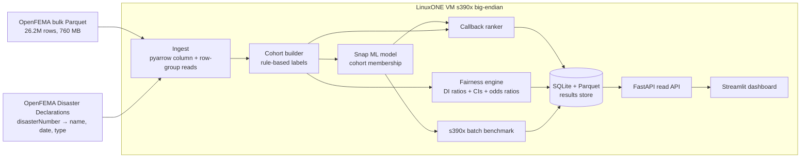

# Second Look: build spec (Devpost "How we built it" format)

IBM Z Datathon 2026 · Theme 3 (Wildcard: Disaster Relief Intelligence) · Event code **SSF2026**
`[X]` = a number we fill in from our own runs. Items marked **(confirm)** must be checked against the data dictionary in hour one.

---

## What it does

Second Look is an audit system for FEMA disaster aid. It finds households whose damage was verified but whose aid was denied for a fixable reason, then hands caseworkers a ranked callback list.

- **Ingests** all 26.2M OpenFEMA Individuals and Households Program (IHP) registrations onto an IBM LinuxONE VM. It reads a 760 MB columnar Parquet file by column and row group, so memory stays small.
- **Builds the Second Look cohort** with deterministic rules on real fields: inspector-verified loss (`rpfvl`/`ppfvl` > 0, `inspnReturned`, `habitabilityRepairsRequired`), denied (`ihpEligible = false`), and a fixable `ineligibleReason` (ownership, occupancy, documentation).
- **Trains an IBM Snap ML gradient-boosting model** on the verified-damage population to learn *which households land in the cohort*, then explains the drivers with feature importance.
- **Measures fairness gaps** across `applicantAge`, `grossIncome`, `ownRent` and `accessFunctionalNeeds`. Reports disparate-impact ratios with 95% Wilson confidence intervals, plus odds ratios controlling for damage level.
- **Ranks a callback list** for each disaster by verified loss × fixability × vulnerability. It flags cases for human review and never decides one.
- **Benchmarks batch scoring** of all 26M records on s390x (records/sec) and documents the big-endian porting work.
- **Serves a Streamlit dashboard:** pick a disaster, see cohort size, fairness charts, the drivers and the top callbacks.

---

## How we built it

Second Look is a batch-plus-serve analytics pipeline. Raw government records become an auditable cohort, a model, fairness evidence and a callback list, all computed on IBM LinuxONE.

### 1) System architecture (end-to-end flow)



**Ingestion layer**
- **Source 1: IHP Valid Registrations V2** in Parquet (~760 MB, 26,242,788 rows, 214 row groups of ~122k rows each). Downloaded from the OpenFEMA bulk file endpoint. The live API was returning 503 during testing, so the pipeline never depends on the API.
- **Source 2: OpenFEMA Disaster Declarations Summaries** (small CSV). Joined on `disasterNumber` to get disaster name, state, incident type and declaration date for the dashboard. **(confirm join key)**
- Reads use `pyarrow.parquet.ParquetFile` with `columns=[...]`, one row group at a time. We never load all 100 columns, so peak RAM stays well under the VM limit.
- Columns used:
  - **Outcome:** `ihpEligible`, `haEligible`, `ineligibleReason`
  - **Damage:** `rpfvl`, `ppfvl`, `homeDamage`, `habitabilityRepairsRequired`, `inspnReturned`, `roofDamage`, `floodDamage`
  - **Demographics:** `applicantAge`, `grossIncome`, `ownRent`, `accessFunctionalNeeds`
  - **Context:** `disasterNumber`, geography fields **(confirm names)**
- Output: `data/processed/ihp_slim.parquet`, the slim working table.

**Cohort layer (rules, on purpose)**
- `verified_damage` = (`rpfvl` > 0 OR `ppfvl` > 0) AND `inspnReturned` AND (`habitabilityRepairsRequired` OR `homeDamage`)
- `denied` = NOT `ihpEligible`
- `fixable` = `ineligibleReason` ∈ {codes for ownership / occupancy / identity / documentation not verified}. The code set comes from the OpenFEMA data dictionary. **(confirm in hour one; the codes are numeric strings '1'–'9')**
- `second_look` = verified_damage AND denied AND fixable
- These are rules, not ML, so every cohort member can be explained in one sentence.

**Model layer (ML)**
- **Population:** verified-damage households only. This avoids the leakage trap: across all applicants, eligibility is almost a function of "loss > 0 and uninsured", so any model scores ~0.99 AUC and learns nothing.
- **Target:** `second_look` (1/0).
- **Features:** damage amounts and flags, age bin, income bin, own/rent, access-and-functional-needs flag, incident type, state. `ineligibleReason` is excluded because it defines the label.
- **Model:** IBM Snap ML `BoostingMachineClassifier`, with scikit-learn `HistGradientBoostingClassifier` as fallback.
- **Split:** by disaster (`disasterNumber`), not by random rows. The test set is disasters the model has never seen, which measures real generalization.
- **Explainability:** feature importance plus scikit-learn permutation importance on the test split.
- **Output:** `models/second_look.joblib` (trained on the VM; see the big-endian note below).

**Fairness layer**
- For each subgroup (age bin, income bin, own/rent, access-and-functional-needs), within the verified-damage population:
  - rate of landing in the second-look cohort
  - **disparate-impact ratio** vs the reference group, with Wilson 95% CIs
  - **adjusted odds ratio** from a logistic regression controlling for damage amount and incident type, so a gap isn't just "renters had less damage"
- Output: `fairness_results` table, plus a chart for each disaster.

**Ranking layer**
- `priority = norm(verified_loss) × fixability_weight(reason) × (1 + vulnerability_bonus)`
- `vulnerability_bonus` is set when age is 65+, the access-and-functional-needs flag is on, or income is in the lowest bin.
- Weights are explicit, documented and shown in the UI. This is a policy choice, not a learned one.
- Output: `callbacks` table (disaster, applicant row id, priority, reason text, loss).

**Benchmark layer (IBM Z)**
- Times batch scoring of all 26.2M rows, row group by row group: records/sec, wall time, peak RAM.
- Run `grep nnpa /proc/cpuinfo`. If NNPA (the Telum accelerator) is present, also time Snap ML with it. If not, report CPU numbers and list Telum as the production path. **Don't claim acceleration we didn't measure.**
- Output: `benchmarks` table + `docs/PORTING.md`.

**Storage layer**
- `data/processed/*.parquet` holds the large intermediate tables.
- `secondlook.db` (SQLite) holds the small serving tables: `disasters`, `cohort_summary`, `fairness_results`, `callbacks`, `benchmarks`, `model_metrics`.

**API layer (FastAPI)**
- A read-only API over the SQLite results, so the dashboard and any future caseworker tool share one source of truth.
- `POST /score` exists to show single-applicant latency on s390x.

**UI layer (Streamlit)**
- **Overview:** national cohort size, top disasters by cohort size, the benchmark card.
- **Disaster view:** cohort count, denial reasons breakdown, fairness bars with CI whiskers, top drivers.
- **Callback list:** sortable table with a "why flagged" sentence for each row. Export to CSV.
- **Method page:** cohort rules, leakage explanation, limits. Judges read this.

### 2) Key implementation layers by technology

- **Compute:** IBM LinuxONE Community Cloud VM (s390x, big-endian), RHEL or Ubuntu per the deploy guide
- **Environment:** Miniconda (s390x build), Python **3.12**. Snap ML has no 3.13 wheel.
- **Packages from conda `defaults`** (PyPI has no s390x wheels for these): `pandas`, `pyarrow`, `scikit-learn`, `numpy`, `scipy`
- **pip:** `snapml` (s390x manylinux wheel exists for cp39–cp312), `fastapi`, `uvicorn`, `streamlit`, `requests`
- **Data:** OpenFEMA IHP Valid Registrations V2 (Parquet), OpenFEMA Disaster Declarations Summaries
- **ML:** IBM Snap ML gradient boosting, scikit-learn (fallback model, permutation importance, logistic regression)
- **Fairness stats:** hand-rolled Wilson CIs and disparate-impact ratios (≈30 lines, no extra dependency)
- **Storage:** Parquet + SQLite
- **Serving / UI:** FastAPI + Streamlit
- **Where AI isn't the answer:** the cohort definition and the callback weights are rules. Eligibility law is written as rules, and a caseworker must be able to read why someone was flagged. ML only finds *patterns* in who gets left behind.

### 3) Representative API surface

- `GET /disasters`: disasters with cohort counts
- `GET /disasters/{disasterNumber}/summary`: cohort size, reason breakdown, model metrics
- `GET /disasters/{disasterNumber}/fairness`: subgroup rates, DI ratios, CIs, adjusted odds ratios
- `GET /disasters/{disasterNumber}/callbacks?limit=50`: ranked list with a "why flagged" sentence
- `POST /score`: score one applicant record, returns probability + top drivers + latency in ms
- `GET /benchmarks`: s390x throughput numbers

### 4) Project folder skeleton

```
second-look/
├─ README.md                         # Problem, results table, setup, event code SSF2026
├─ environment.yml                   # conda (defaults channel) env: python=3.12, pandas, pyarrow, sklearn
├─ requirements-pip.txt              # snapml, fastapi, uvicorn, streamlit, requests
├─ Makefile                          # make data / cohort / train / fairness / rank / bench / serve
├─ config.py                         # Paths, column lists, fixable reason codes, ranking weights
├─ data/
│  ├─ raw/                           # IHP parquet + disaster declarations csv (gitignored)
│  └─ processed/                     # ihp_slim.parquet, cohort.parquet, scores.parquet (gitignored)
├─ pipeline/
│  ├─ download.py                    # Fetch bulk parquet + declarations with resume support
│  ├─ ingest.py                      # Row-group column reads → ihp_slim.parquet
│  ├─ codebook.py                    # ineligibleReason code → label + fixable flag (from data dictionary)
│  ├─ cohort.py                      # verified_damage / denied / fixable / second_look rules
│  ├─ features.py                    # Feature engineering + disaster-based split
│  ├─ train.py                       # Snap ML (fallback sklearn), metrics, save model
│  ├─ explain.py                     # Feature + permutation importance
│  ├─ fairness.py                    # Subgroup rates, DI ratios, Wilson CIs, adjusted odds ratios
│  ├─ rank.py                        # Priority score + "why flagged" sentence
│  ├─ bench.py                       # 26M-row batch scoring timer, NNPA check
│  └─ store.py                       # Write serving tables into secondlook.db
├─ api/
│  └─ main.py                        # FastAPI read API + POST /score
├─ dashboard/
│  └─ app.py                         # Streamlit: overview, disaster view, callbacks, method page
├─ eval/
│  ├─ eval.ipynb                     # All metrics + charts for the write-up
│  └─ handcheck_sample.csv           # Top-100 callbacks manually checked against cohort rules
├─ tests/
│  ├─ test_cohort.py                 # Rule edge cases: null reasons, zero loss, missing inspection
│  ├─ test_fairness.py               # CI math on known small inputs
│  └─ test_rank.py                   # Ordering + weight behavior
└─ docs/
   ├─ PORTING.md                     # s390x / big-endian notes, conda vs pip, NNPA result
   └─ METHOD.md                      # Cohort definition, leakage trap, limits, ethics
```

### 5) Setup on the LinuxONE VM (exact steps)

```bash
grep -m1 -o nnpa /proc/cpuinfo || echo "no NNPA"
```
```bash
wget https://repo.anaconda.com/miniconda/Miniconda3-latest-Linux-s390x.sh
```
```bash
bash Miniconda3-latest-Linux-s390x.sh -b -p $HOME/miniconda3
```
```bash
$HOME/miniconda3/bin/conda create -y -n sl -c defaults python=3.12 pandas pyarrow scikit-learn numpy scipy
```
```bash
$HOME/miniconda3/envs/sl/bin/pip install snapml fastapi uvicorn streamlit requests
```

### 6) Big-endian notes (goes in PORTING.md, past winners got credit for this)

- Train the model **on the VM**. Don't move pickles across architectures.
- Parquet is endian-neutral, so the same data file works on a Mac and on s390x.
- Install everything from conda `defaults`, not pip: pip tries to compile pyarrow and pandas from source on s390x.
- Record anything that broke and how it was fixed. That *is* the porting story.

---

## Metrics (fill from our runs)

| Metric | Value |
|---|---|
| Verified-damage households | [X] |
| Second Look cohort (national / per top disaster) | [X] / [X] |
| Model AUC on unseen disasters (cohort membership) | [X] |
| Precision@100 on the hand-checked callback sample | [X] |
| Largest disparate-impact ratio (group, 95% CI) | [X] |
| Adjusted odds ratio for that group (controlling for damage) | [X] |
| Batch scoring throughput on s390x | [X] records/sec, 26.2M in [X] min |
| `POST /score` p50 latency | [X] ms |

## Challenges (expected, write honestly)

- **Leakage trap:** eligibility is nearly a rule, so we restricted the model to verified-damage households and split by disaster.
- **Proxy label:** "fixable" is our reading of FEMA's reason codes, not a court finding. We flag cases for review and never decide them.
- **API outage:** the OpenFEMA API returned 503, so the pipeline runs entirely from bulk files.
- **s390x packaging:** no pip wheels for the core stack. We used conda `defaults` and pinned Python 3.12 for Snap ML.

## What's next

- **Optional privacy add-on (the "Sealed" version):**
  - CPACF-backed tokenization of applicant identities
  - two-person audited unmasking
  - a quasi-identifier re-identification risk audit on the public release, reporting aggregate uniqueness only
- Run beside the agency system of record (Db2) instead of a public extract.
- Caseworker outreach integration: export to case-management queues.
- Extend to SBA disaster loans and HUD data.

## Timeline (due ~22:42 Oct 18)

| When | What |
|---|---|
| Hour 0–1 | VM + conda env, start parquet download, **decode `ineligibleReason`** |
| 1–3 | ingest.py, cohort.py, first cohort counts (go/no-go checkpoint) |
| 3–4 | Sleep window starts if solo |
| 8–11 | features.py, train.py, explain.py |
| 11–13 | fairness.py, rank.py, store.py |
| 13–15 | bench.py on the full 26M rows, PORTING.md |
| 15–18 | api/main.py, dashboard/app.py |
| 18–20 | eval.ipynb, hand-check sample, fill metrics |
| 20–22 | Demo video + Devpost write-up from this file, submit with SSF2026 |
