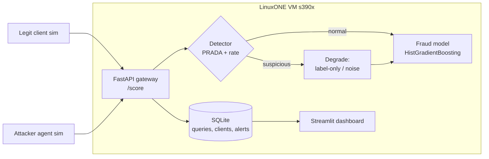

# Clonewall: stop AI agents from cloning your model through its API

IBM Z Datathon 2026 · Event code: SSF2026 · Deadline: ~22:42 Oct 18 (verify in guidebook)

## 1. Problem

Tools like REA let an AI agent reverse engineer an app down to the binary. The standard answer is "keep the valuable logic on the server." But a server-side model is still exposed through its API: an attacker can send thousands of queries, record the answers, and train a near-identical copy (a **model extraction attack**). With an agent automating it, cloning a bank's fraud model takes hours, and the clone then tells the attacker exactly which transactions slip through.

Who it hurts: banks and payment processors, most of whom run fraud scoring on IBM Z.

## 2. What it does

Clonewall is a gateway in front of the model with three layers:

| Layer | What it does | How |
|---|---|---|
| Detect | Flags clients whose query stream looks like extraction | PRADA: per client, track min L2 distance from each new query to that client's prior queries. Real traffic gives a roughly normal distance distribution; synthetic attack queries don't. Shapiro-Wilk test, flag when W < threshold. Plus simple rate/coverage features. |
| Degrade | Makes the clone worse once a client is suspicious | Return label only (no probability), round scores, or add calibrated noise near the decision boundary |
| Prove | Lets you prove a model is a stolen copy | Secret canary inputs with a fixed signature output. Query a suspect model with them; high agreement = stolen. |

## 3. Architecture



## 4. Data

- **Source:** Credit Card Fraud Detection (ULB, 284,807 transactions, 492 fraud, 30 features: Time, Amount, V1-V28 PCA). Load with `sklearn.datasets.fetch_openml(data_id=1597)`; fallback Kaggle CSV.
- **Split:**
  - 60% victim training
  - 20% "legit client" traffic pool (realistic queries)
  - 20% held-out test, used to measure clone fidelity
- **Attacker knowledge:** feature names and ranges only, no real rows. That's a realistic assumption since the API docs leak the schema.

## 5. Storage (SQLite, `clonewall.db`)

```sql
CREATE TABLE queries (
  id INTEGER PRIMARY KEY, client_id TEXT, ts REAL,
  features BLOB,          -- float32 array, 30 values
  score REAL, label INTEGER, degraded INTEGER
);
CREATE TABLE clients (
  client_id TEXT PRIMARY KEY, n_queries INTEGER,
  prada_w REAL, flagged INTEGER, flagged_at REAL
);
CREATE TABLE alerts (
  id INTEGER PRIMARY KEY, client_id TEXT, ts REAL, reason TEXT, w_stat REAL
);
```

Why SQLite: one file, ships with Python, enough for demo volume. Production version: Db2 on Z, mentioned in "What's next."

## 6. Components and files

```
clonewall/
  data.py          load + split dataset
  victim.py        train fraud model, save victim.joblib
  gateway.py       FastAPI: POST /score {client_id, features}; logs, detects, degrades
  detector.py      PRADA (min-distance buffer + Shapiro-Wilk) + rate features
  defenses.py      label-only, rounding, boundary noise
  watermark.py     generate canaries, fine-tune victim to answer them, verify suspect
  sim_legit.py     replays rows from legit pool at human-ish rates
  sim_attack.py    attacker: random-in-range + Jacobian augmentation queries, trains surrogate
  eval.ipynb       all metrics + charts (this is your evidence)
  dashboard.py     Streamlit: live clients, W-stat per client, alerts, shield on/off
  README.md
```

## 7. Walkthrough (what happens in the demo)

1. Start gateway + dashboard on the LinuxONE VM.
2. Run 5 legit clients. Dashboard: all green, W-stat stays high.
3. Run the attacker with the shield OFF. It sends ~5k queries and trains a surrogate. Show fidelity (agreement with victim on test set) and the surrogate's fraud recall. Example target: ~95% agreement.
4. Turn the shield ON, rerun. The attacker gets flagged after N queries, starts receiving degraded answers, and the clone's fidelity drops. Show the before/after chart.
5. Run the watermark check against the clone made with the shield off. Canary agreement is far above chance, so the clone is provably derived from your model.
6. Show legit-client false-positive rate stays near 0.

## 8. Metrics to report (measure, don't claim)

| Metric | Meaning |
|---|---|
| Victim AUPRC / recall@1% FPR | Fraud model quality (use AUPRC, data is 0.17% fraud) |
| Clone fidelity, shield off vs on | Core result |
| Queries-to-detection (median) | How fast attackers get caught |
| Detection rate across 20 attack runs | Reliability |
| False-positive rate across 50 legit clients | Cost to real users |
| Watermark agreement: stolen clone vs independent model | Proof strength |
| Gateway p50 latency added | Overhead |

## 9. Timeline (24h)

| Time | Task |
|---|---|
| 23:00-00:00 | LinuxONE signup + VM request, Discord, guidebook. Set up repo locally meanwhile. |
| 00:00-02:00 | data.py, victim.py; baseline AUPRC |
| 02:00-04:00 | sim_attack.py with shield off; get the fidelity number |
| 04:00-08:00 | Sleep. Don't skip it. |
| 08:00-11:00 | detector.py + gateway.py; sim_legit.py; tune threshold on FP rate |
| 11:00-13:00 | defenses.py; rerun attack, shield on |
| 13:00-15:00 | watermark.py (cut first if behind) |
| 15:00-17:00 | Move to LinuxONE VM, run full eval there, note latency |
| 17:00-19:00 | Streamlit dashboard |
| 19:00-21:00 | Demo video (2-3 min), screenshots, architecture image |
| 21:00-22:00 | Devpost write-up, add SSF2026, submit. 40 min buffer. |

## 10. Risks

- **s390x packages:** Some wheels are missing on s390x (big-endian). Use the jupyter-lab-ml environment, which bundles prebuilt ML libraries. Stick to sklearn/scipy/numpy/pandas/fastapi/streamlit. Ask in #ibm-z-sme-helpdesk early if pip fails.
- **VM approval delay:** Build locally on your Mac and move it over. Code is plain Python.
- **Adaptive attacker:** A smart attacker can mimic the natural distance distribution. Acknowledge it in "Challenges"; judges respect honesty. Rate limits + degradation still raise the cost.
- **Solo time crunch:** Cut order: watermark, then dashboard polish, then Jacobian attack (keep random-in-range).

## 11. Devpost write-up template

Pattern taken from Nudge / aide / Angel's Protection: sharp human problem up front, what it does in 3 short labeled bullets, a stack table saying *why* each tool mattered, real measured numbers, honest about where AI isn't the answer.

```
# Clonewall: your model's API is its source code now

## The problem
[2-3 sentences: AI agents reverse engineer apps (REA); the fix is keeping models
server-side; but extraction attacks clone them through the API. Banks on IBM Z.]

## What it does
- Detect: ...
- Degrade: ...
- Prove: ...

## How we measured it
[Metrics table with real numbers from eval.ipynb.]

## Why IBM Z / LinuxONE
[Banks' fraud scoring runs on Z; we ran the whole gateway + model on a LinuxONE VM;
p50 overhead X ms. Next step: Secure Execution so even the host can't read the model.]

## Where AI isn't the answer
[Detector is a statistical test, not a neural net: explainable, cheap, auditable.]

## Built with
| What | Why it mattered |
| LinuxONE Community Cloud | ... |
| scikit-learn | ... |
| FastAPI | ... |
| SQLite | ... |
| Streamlit | ... |
| SciPy (Shapiro-Wilk) | ... |

## Challenges
## What we learned
## What's next
- Run inside IBM Secure Execution / Hyper Protect Virtual Servers
- Use Telum on-chip AI for in-transaction scoring
- Db2 for the query log at bank scale
- Defend against adaptive attackers (cross-client correlation, sybil detection)

Event code: SSF2026
```

## 12. References

- Juuti et al., "PRADA: Protecting against DNN Model Stealing Attacks," IEEE EuroS&P 2019
- Tramèr et al., "Stealing Machine Learning Models via Prediction APIs," USENIX Security 2016
- Jia et al., "Entangled Watermarks as a Defense against Model Extraction," USENIX Security 2021
